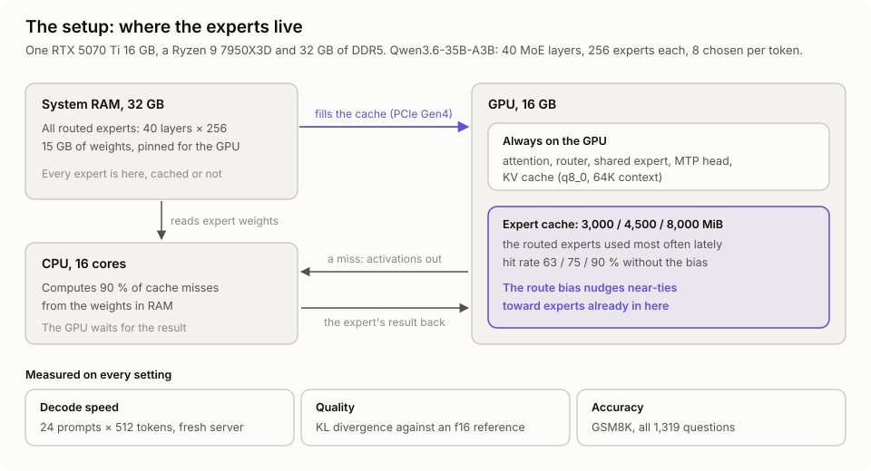
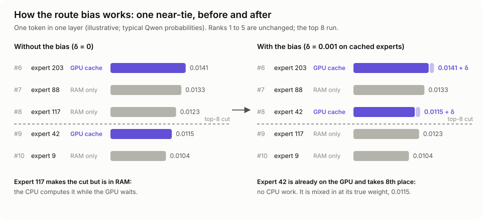
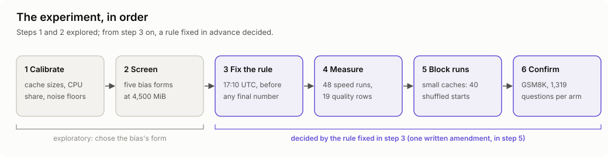
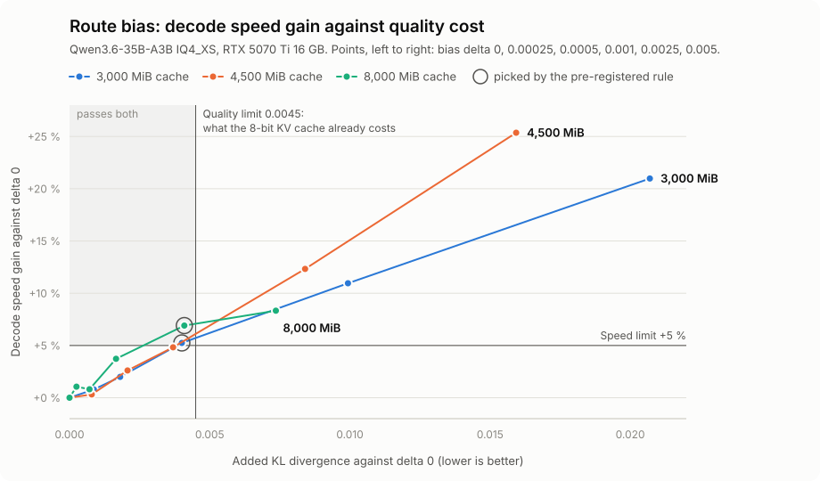
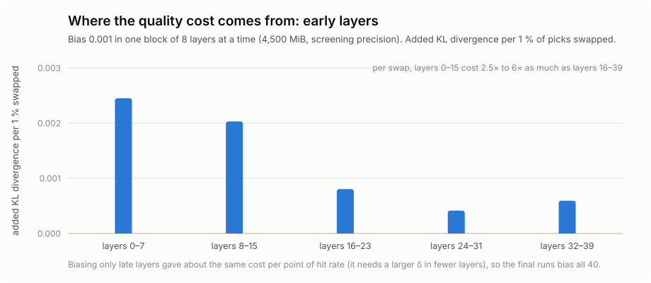

# Route bias on Qwen3.6-35B-A3B: trading routing fidelity for decode speed on a 16 GB GPU

**One small nudge to a mixture-of-experts router, measured end to end on a consumer PC.** Within a quality budget equal to the cost of
an 8-bit KV cache, it makes Qwen3.6-35B-A3B decode **about 5 % faster with a 3 GB expert cache and about 7 % faster with an 8 GB
one**, with no significant loss on GSM8K. Spend more quality and it gives **+21 to +25 %**.

- **What it is:** the route bias from Killy's [glm53-offload](https://github.com/killy-netsphere/glm53-offload), first measured on
  GLM-5.3 with two 96 GB cards. This project takes it to a different model family and to a single 16 GB card.
- **How it was measured:** decode speed, KL divergence against an f16 reference, and GSM8K accuracy, under a pass rule fixed and
  hashed before the final runs.
- **What it found:** the full speed-quality curve at three cache sizes, which settings stay within a strict quality budget, and which
  layers the quality cost comes from.

## How it works

A 35B mixture-of-experts model doesn't fit in 16 GB of VRAM. In each of its 40 MoE layers, every token picks 8 of 256 experts. All the
routed experts live in system RAM, and the GPU keeps a cache of the ones used most. A routed expert in the cache runs on the GPU.
For a missed one, the GPU sends the token's activations to the CPU, which computes that expert from RAM while the GPU waits.

<picture>
  <source media="(prefers-color-scheme: dark)" srcset="docs/setup-dark.svg">
  
</picture>

The **route bias** adds a small constant δ to the router's probability of every expert that is already in the GPU cache, before the
top-8 choice. Most choices don't change. But the router is full of near-ties, and when an expert in RAM narrowly beats a cached one,
the bias hands the place to the cached expert. The mixing weights stay unbiased: an expert that gets in through the bias still counts
at its true probability.

<picture>
  <source media="(prefers-color-scheme: dark)" srcset="docs/bias-dark.svg">
  
</picture>

The cost is fidelity: the model now sometimes uses its 9th-choice expert instead of its 8th. This project measures how much speed
that buys and how much quality it costs.

## What's new here

The original glm53-offload results are one setting on one model: GLM-5.3, δ = 0.03, GPU hit rate 79 → 89 %, decode +26 %. This
project adds:

1. **A different kind of router.** GLM-5.3 routes with sigmoid scores plus a per-expert selection bias, so there the bonus folds into
   that term. Qwen routes with a softmax and has no such term. Here the bonus is added to the softmax probabilities, and only in that
   additive form: adding it in logit space breaks the fused CUDA top-k kernel and costs about 5 % before a single choice changes.
2. **A consumer machine.** One 16 GB card that also runs the desktop, 3 to 8 GB expert caches and 63 to 90 % hit rates, against the
   original's 192 GB of VRAM. At 4,500 MiB, δ = 0.005 takes the hit rate from 75 to 87 % and decode up 25 %: about the size of the
   original's effect, on a far smaller machine.
3. **The whole curve, not one point.** Five deltas at three cache sizes. Quality is paired position by position against δ = 0 over
   32,752 positions, with block-bootstrap intervals. The swap counter added for this leaves the fast path bit-identical.
4. **Findings specific to this model:**
   - **Qwen's router is full of near-ties:** at the 3 and 4.5 GB caches, δ = 0.00026 already swaps 1 % of all expert picks.
   - **Early layers cost several times more quality per swap than late ones,** yet biasing all 40 layers uniformly is still best.
   - **Larger caches tolerate larger δ,** because fewer choices can flip.
   - **Each point of hit rate is worth about 1.5 to 2 % of decode speed.**
5. **A task-level check:** GSM8K on all 1,319 questions, each pick against δ = 0 on the same questions with McNemar's test.

## The experiment

<picture>
  <source media="(prefers-color-scheme: dark)" srcset="docs/pipeline-dark.svg">
  
</picture>

| | |
|---|---|
| **Hardware** | RTX 5070 Ti 16 GB (PCIe Gen4 x16, NVIDIA driver 620.70.06, also driving the desktop), Ryzen 9 7950X3D, 32 GB DDR5-5200 |
| **Model** | [Qwen3.6-35B-A3B](https://huggingface.co/unsloth/Qwen3.6-35B-A3B-MTP-GGUF), UD-IQ4_XS (18.2 GB), MTP drafting 2 tokens |
| **Engine** | llama.cpp d02b4c0d + glm53-offload b5e86ee + [two patches](patches/); expert cache of 3,000, 4,500 or 8,000 MiB; 90 % of misses on the CPU; q8_0 KV cache, 64K context |
| **Bias tested** | additive, all 40 layers, δ = 0, 0.00025, 0.0005, 0.001, 0.0025, 0.005 |
| **Speed** | 24 prompts × 512 greedy tokens, thinking on (glm53-offload's benchmark); a fresh server per run; interleaved δ = 0 runs; at 3,000 and 4,500 MiB, the median of 5 shuffled blocks |
| **Quality** | `llama-perplexity` KL-divergence mode on wikitext-2: 16 × 4,096-token chunks, 32,752 scored positions, 3-token steps, against an f16-KV reference with every expert on the GPU |
| **Accuracy** | GSM8K test set (1,319), thinking off, greedy, 768 tokens max, MTP on |

**The pass rule,** fixed at 17:10 UTC on 2026-11-18 before any final number was read
([PREREGISTRATION.md](results/PREREGISTRATION.md), sha256 `f1ec8923…63aa`). A δ passes when it is at least 5 % faster than δ = 0, adds
at most 0.0045 KL divergence, and keeps perplexity within 1 %. The fastest passing δ is picked, and GSM8K withdraws a pick that scores
worse at p < 0.05.

**One amendment,** fixed before its runs ([AMENDMENT-1.md](results/AMENDMENT-1.md)): at 3,000 and 4,500 MiB, every quality-passing δ
was measured in 5 shuffled blocks (40 fresh starts) and scored by the median block gain, for more precision than two runs per setting.

## Results

<picture>
  <source media="(prefers-color-scheme: dark)" srcset="docs/frontier-dark.svg">
  
</picture>

| GPU expert cache | Hit rate, δ = 0 | Pick | Decode gain | Added KL divergence | GSM8K, δ = 0 → pick |
|---|---|---|---|---|---|
| 3,000 MiB | 63 % | δ = 0.001 | +5.3 % | +0.0040 | 94.77 % → 94.39 % (−0.38 points [−1.21, +0.45], p = 0.47) |
| 4,500 MiB | 75 % | none passes | +4.8 % at δ = 0.001 | +0.0037 | — |
| 8,000 MiB | 90 % | δ = 0.0025 | +6.9 % | +0.0041 | 95.07 % → 94.54 % (−0.53 points [−1.29, +0.23], p = 0.23) |

- **About +5 % at small caches, +7 % at 8,000 MiB, inside the budget.** δ = 0.001 gives about +5 % at both 3,000 and 4,500 MiB
  (+5.3 % and +4.8 %). One clearing the 5 % line and the other missing it is within the measurement's precision, not a real
  difference.
- **On GSM8K the picks decoded even faster:** +9.2 % and +10.7 % (one run each). Neither lost significant accuracy, though both point
  estimates are about half a point lower, and a test this size can't rule out losses up to about 1.3 points.
- **Past the budget the speed keeps coming.** δ = 0.005 gives +21 % at 3,000 MiB and +25 % at 4,500 MiB, at four to five times the
  quality cost: the top token differs from δ = 0's at an extra 2.9 to 3.7 % of positions, against about 1 % for the picks.
- **Perplexity barely moves:** under 0.8 % for any setting. KL divergence and same-top-token agreement are the sensitive measures.

<picture>
  <source media="(prefers-color-scheme: dark)" srcset="docs/layers-dark.svg">
  
</picture>

Screening showed the model is far more sensitive to swaps in its first 16 layers. Even so, no layer-restricted or layer-weighted bias
beat the uniform one. Getting the same hit-rate gain from fewer layers takes a larger δ there, which costs about as much.

The full tables, intervals and per-setting numbers are in [results/final/RESULTS.md](results/final/RESULTS.md). Calibration and
screening are in [results/calib/CALIBRATION.md](results/calib/CALIBRATION.md).

## Reproducing

**Check the analysis** from the included data (Python 3 and NumPy, no GPU):

```bash
python3 scripts/speed_compare.py          # final speed sweep, registered statistic
```
```bash
python3 scripts/speed_blocks.py           # 3,000 and 4,500 MiB in 5 shuffled blocks, block medians
```
```bash
python3 scripts/paired.py --vs results/kld/q16-8000-d0 results/kld/q16-8000-add0.0025   # paired quality
```
```bash
python3 scripts/apply_rule.py             # the pass rule as registered
```
```bash
python3 scripts/figures.py                # redraw every figure in docs/
```

**Run the experiment** (Linux, an NVIDIA GPU, [distrobox](https://distrobox.it/), about 20 GB of disk, 32 GB of RAM):

```bash
scripts/setup.sh                 # llama.cpp d02b4c0d + glm53-offload b5e86ee + patches/, into third_party/
```
```bash
scripts/get-data.sh --model      # wikitext-2, GSM8K and the 18.2 GB model, checksummed
```
```bash
distrobox create --yes --name cuda13 --nvidia --image docker.io/nvidia/cuda:13.0.0-devel-ubuntu24.04@sha256:1e8ac7a54c184a1af8ef2167f28fa98281892a835c981ebcddb1fad04bdd452d --additional-flags "--log-driver=k8s-file"
```
```bash
distrobox enter cuda13 -- sudo apt-get install -y --no-install-recommends git cmake ninja-build build-essential libcurl4-openssl-dev ca-certificates python3
```
```bash
distrobox enter cuda13 -- scripts/build.sh
```
```bash
scripts/sweep.sh sweeps/speed-final.txt       # then scripts/kld_sweep.sh sweeps/kld-final.txt, and so on
```

Notes on the build and setup:
- **CUDA 13.0 is pinned,** as in glm53-offload: 13.2 miscompiles IQ kernels on sm_120.
- **The container's log driver:** `--log-driver=k8s-file` keeps journald's rate limit from stalling `distrobox enter`.
- **Other GPUs:** `scripts/build.sh` targets sm_120 (RTX 50-series); change `CMAKE_CUDA_ARCHITECTURES` for others.
- **Why glm53-offload, despite the name:** its llama.cpp patch carries the general MoE-offload engine, not just GLM support. That
  means the expert cache (built on llama.cpp pull requests #29963 and #30966), CPU computation of misses and the route bias itself.
  Its GLM-specific kernels go unused with Qwen.
- **Work sharing (patch 0003, on by default in `scripts/serve.sh`):** in a decode step, the CPU threads take the rows of the small
  expert matrices from one shared queue instead of a fixed share each, which keeps decode speed steady from one server start to
  the next. In 60 fresh starts with it, the slowest was 2.0 % below the median; with the fixed split, 4 of 60 starts ran 9–11 %
  below. The output is byte-identical and the median speed unchanged, so the results above (measured with the fixed split) stand;
  `--no-work-share` restores the fixed split.

## Repository layout

```
patches/        this project's three llama.cpp patches (applied after glm53-offload's)
scripts/        setup, build, server, benchmark, quality, analysis and figure scripts (each documents itself at the top)
sweeps/         the run lists, in the order they ran
results/
  final/        RESULTS.md and the analysis output it quotes
  calib/        CALIBRATION.md, sweep logs, the δ-to-swap-rate map
  kld/          one folder per quality row: command, log, per-position dump (positions.bin)
  runs/         one folder per speed or GSM8K run: per-prompt results, GPU telemetry, manifest
  PREREGISTRATION.md, AMENDMENT-1.md
docs/           the figures (scripts/figures.py draws them from results/)
```

Every number in the write-ups can be recomputed from these files. Left out for size: server logs, per-token routing records, the
reference logits, the model and the data (`scripts/get-data.sh` fetches the last two).

## Credits

- **Killy** ([killy-netsphere/glm53-offload](https://github.com/killy-netsphere/glm53-offload), MIT): the route bias, the expert-cache
  engine patch, the benchmark prompts and probe, and the pre-registered method this project follows.
- **[llama.cpp](https://github.com/ggml-org/llama.cpp)** (MIT).
- **Model:** the Qwen team for Qwen3.6-35B-A3B; [unsloth](https://huggingface.co/unsloth/Qwen3.6-35B-A3B-MTP-GGUF) for the GGUF.
- **Data:** wikitext-2 (CC BY-SA), and GSM8K ([openai/grade-school-math](https://github.com/openai/grade-school-math), MIT).

## License

MIT, see [LICENSE](LICENSE). The fetched third-party code, model and data keep their own licenses.
